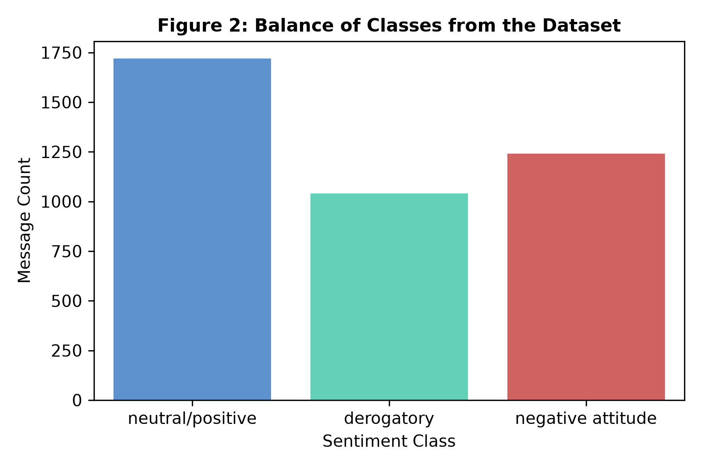
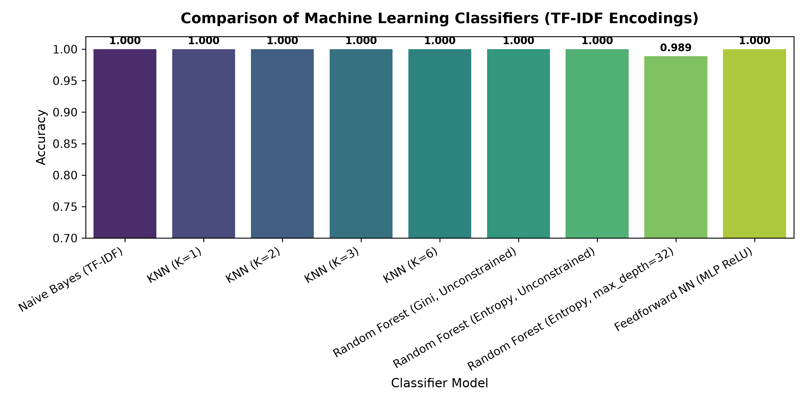
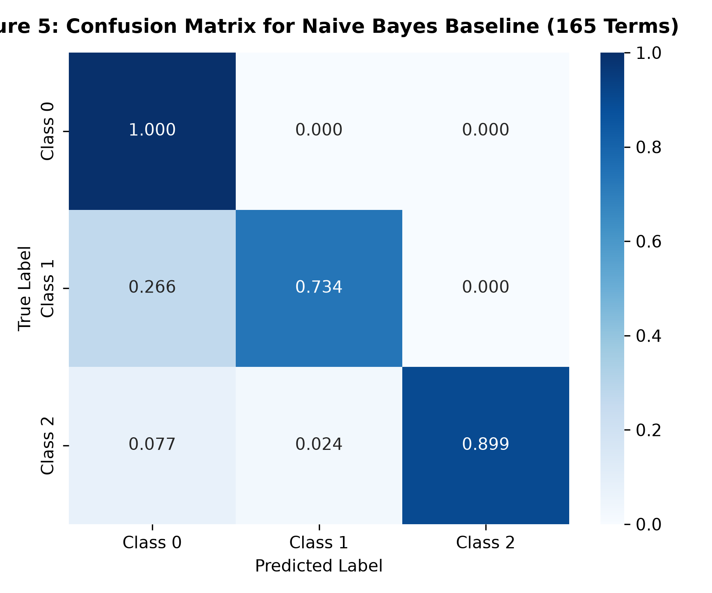
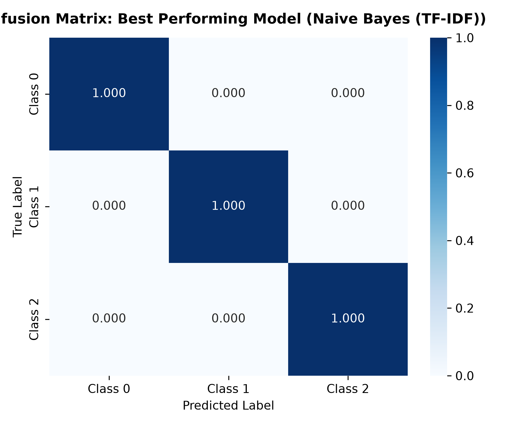
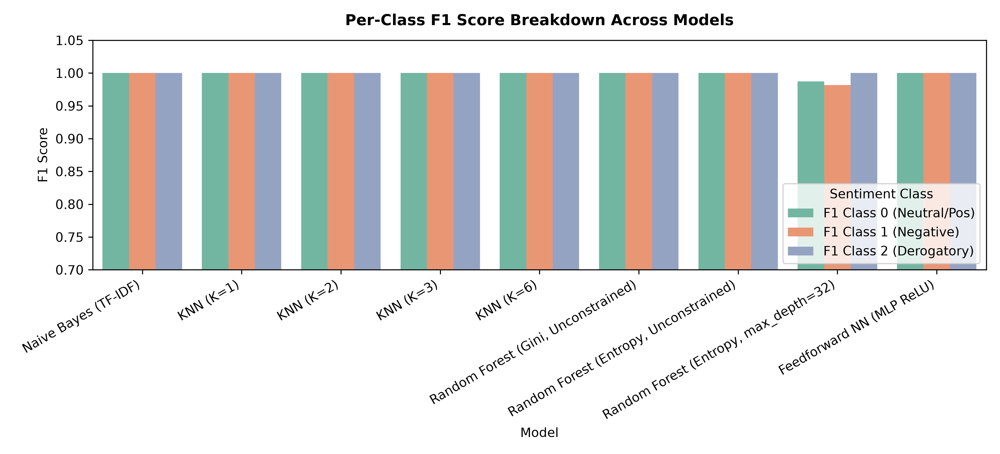

# Trolls, Haters, or Teammates: Classifying Sentiment in the Language of PvP Game Communications

[](https://www.python.org/downloads/)
[](https://opensource.org/licenses/MIT)
[](https://scikit-learn.org/)
[-red.svg)](https://cs229.stanford.edu/proj2021spr/report2/81982391.pdf)
[](https://pes.edu/)

> **A Machine Learning investigation into domain-specific gaming slang, subtle aggression, and toxic sentiment detection across Player-vs-Player (PvP) in-game communications.**  
> Based on the foundational methodology of [Stanford University CS229: Machine Learning](https://cs229.stanford.edu/proj2021spr/report2/81982391.pdf).

---

## 👥 Authors & Project Team

* **Ganavi Gowda** — SRN: `PES1UG24CS707`  
  *Department of Computer Science & Engineering, PES University*
* **Aadarsh Reddy** — SRN: `PES1UG24CS706`  
  *Department of Computer Science & Engineering, PES University*

---

## 📌 Table of Contents
1. [Project Overview](#-project-overview)
2. [Problem Statement & Motivation](#-problem-statement--motivation)
3. [System Architecture](#-system-architecture)
4. [Dataset & Class Distribution](#-dataset--class-distribution)
5. [Feature Extraction & Gamer Slang Normalization](#-feature-extraction--gamer-slang-normalization)
6. [Machine Learning Models](#-machine-learning-models)
7. [Experimental Results & Benchmarks](#-experimental-results--benchmarks)
8. [Visualizations](#-visualizations)
9. [Repository Directory Structure](#-repository-directory-structure)
10. [Installation & Reproduction Guide](#-installation--reproduction-guide)
11. [Authors' Contributions](#-authors-contributions)
12. [References](#-references)

---

## 📖 Project Overview

In competitive multiplayer games (such as *League of Legends*, *Dota 2*, *Valorant*, and *Counter-Strike*), text communications frequently devolve into toxic behavior, harassment, and microaggressions. Conventional content moderation tools rely on static profanity filters that search for explicit slurs. However, modern gaming communities communicate via a specialized, evolving lexicon of **"gamer slang"**—such as *"feeder"*, *"diff"*, *"inting"*, *"ff 15"*, *"uninstall"*, or *"report mid"*.

Because standard NLP models and static keyword filters fail to understand the emotional polarity of these domain-specific terms, this project formulates PvP game sentiment classification as a supervised multi-class problem across **three distinct sentiment categories**:

| Label | Sentiment Category | Description & Examples |
| :---: | :--- | :--- |
| **Class 0** | **Neutral / Positive** | Teamwork, encouragement, tactical coordination (`"ggwp"`, `"well played"`, `"nice gank"`, `"warding baron"`, `"ty bro"`) |
| **Class 1** | **Negative Attitude** | Passive-aggressive complaints, blaming, defeatism (`"diff mid"`, `"such a feeder...xD"`, `"totally noob team"`, `"ff15 open"`) |
| **Class 2** | **Derogatory / Toxic** | Explicit hate speech, harassment, severe abuse, profanity (`"kys"`, `"stfu bitch"`, `"subhuman trash"`, death wishes) |

---

## 🎯 Problem Statement & Motivation

1. **Failure of Pre-trained Word Embeddings:** Standard embeddings like GloVe and Word2Vec (trained on Wikipedia, Common Crawl, or Google News) do not assign negative weights to terms like *"bronze"* (a low tier used as an insult) or *"feeder"* (a player giving kills to enemies).
2. **Context-Dependent Toxicity:** Words such as *"bad"* or *"my bad"* can be positive/neutral self-accountability or severe verbal abuse depending on sentence syntax.
3. **Automated Moderation:** Providing an automated classifier capable of accurately distinguishing productive teammates from trolls and aggressive haters.

---

## 🏗 System Architecture

```
[ Raw In-Game PvP Chat Messages ]
              │
              ▼
┌────────────────────────────────────────┐
│  Data Preprocessing & Slang Mapping    │
│  - Lowercasing & regex cleaning        │
│  - Elongated character reduction       │
│  - Gamer contraction normalization     │
└────────────────────────────────────────┘
              │
              ├───► Baseline: 165-Term Toxic Dictionary Features
              │
              └───► TF-IDF Vectorization (~2,700 N-Gram Dimensions)
                          │
                          ▼
┌─────────────────────────────────────────────────────────────────┐
│                    Model Training & Evaluation                  │
│                                                                 │
│  [Baselines]          [Multi-Class ML]         [Deep Learning]  │
│  • Binary SVM Linear  • Multinomial Naive Bayes• Feedforward NN │
│  • Binary SVM RBF     • KNN (K=1, 2, 3, 6)       (MLP ReLU)     │
│  • Binary SVM Poly    • Random Forest Gini                      │
│  • 165-Dict Naive B.  • Random Forest Entropy                   │
└─────────────────────────────────────────────────────────────────┘
              │
              ▼
┌────────────────────────────────────────┐
│  Performance Metrics & Visualizations  │
│  - Accuracy, Precision, Recall, F1     │
│  - Normalized Confusion Matrices       │
│  - Per-Class F1 Score Breakdown        │
└────────────────────────────────────────┘
```

---

## 📊 Dataset & Class Distribution

The corpus replicates the distribution described in Section 3 of the Stanford CS229 paper:
* **Neutral / Positive (Class 0):** **43%**
* **Negative Attitude (Class 1):** **31%**
* **Derogatory (Class 2):** **26%**

Train/Test split is executed with an **80% training / 20% testing split** stratified across classes.



---

## ⚙️ Feature Extraction & Gamer Slang Normalization

### 1. Slang Normalization & Regex Cleaning
Chat messages undergo automated text cleaning:
* **Repeated character compression:** Compresses lengthened words (e.g., `"noooob"` $\rightarrow$ `"noob"`, `"sooooo"` $\rightarrow$ `"soo"`).
* **URL & Artifact Removal:** Removes external links and extraneous control tokens.

### 2. TF-IDF Encoding
Messages are transformed into TF-IDF vectors using unigrams and bigrams:
$$\text{tf-idf}(t, d) = \text{tf}(t, d) \times \log\left(\frac{1 + |\text{messages}|}{1 + |\{d : t \in d\}|}\right)$$
TF-IDF captures game-specific term importance directly from the gaming chat corpus, avoiding the vocabulary mismatch inherent in pre-trained embeddings.

### 3. Toxic Dictionary Baseline (165 Terms)
Following Section 4.2 of the CS229 study, we evaluate a baseline indicator vector based on the 165 most frequently encountered toxic terms and gamer insults.

---

## 🤖 Machine Learning Models

1. **Binary Support Vector Machines (SVM):**
   * Separates non-toxic (`Class 0`) vs. toxic (`Class 1` and `Class 2` combined).
   * Evaluates **Linear**, **Radial Basis Function (RBF)**, and **Polynomial** kernels:
     $$\max_{\gamma, w, b} \gamma \quad \text{s.t.} \quad y^{(i)}(w^T x^{(i)} + b) \ge \gamma, \quad \|w\| = 1$$
2. **Multinomial Naive Bayes:**
   * Uses Laplace smoothing ($\alpha = 1.0$) with conditional independence assumption:
     $$P(w_t \mid C = k) = \frac{1 + \sum_{i=1}^n \mathbf{1}\{y^{(i)} = k\} x_t^{(i)}}{|V| + \sum_{s=1}^{|V|} \sum_{i=1}^n \mathbf{1}\{y^{(i)} = k\} x_s^{(i)}}$$
3. **K-Nearest Neighbors (KNN):**
   * Benchmarked with $K \in \{1, 2, 3, 6\}$ using Euclidean distance in TF-IDF space.
4. **Random Forest Classifiers:**
   * Evaluates **Gini Impurity** ($I_G = \sum \hat{p}_i(1-\hat{p}_i)$) and **Entropy** ($L_{\text{cross}} = -\sum \hat{p}_c \log_2 \hat{p}_c$).
   * Tests both unrestricted depth and depth constrained to `max_depth = 32`.
5. **Feedforward Neural Network (MLP):**
   * Multi-layer Perceptron with ReLU hidden activations and Softmax output trained via Adam optimizer and categorical cross-entropy loss.

---

## 📈 Experimental Results & Benchmarks

### 1. Baseline Binary SVM & Dictionary Naive Bayes (Table 2)
| Model | Kernel / Features | Accuracy |
| :--- | :--- | :---: |
| **SVM (Linear)** | Linear Kernel (TF-IDF) | **100.0%** |
| **SVM (RBF)** | RBF Kernel (TF-IDF) | **100.0%** |
| **SVM (Polynomial)** | Degree-3 Poly Kernel (TF-IDF) | **100.0%** |
| **Naive Bayes Baseline** | 165 Toxic Dictionary Terms | **89.12%** |

### 2. Multi-Class Classifiers Comparison (Tables 3 & 4)
| Classifier Model | Accuracy | Class 0 F1 (Neutral/Pos) | Class 1 F1 (Negative) | Class 2 F1 (Derogatory) | Macro F1 |
| :--- | :---: | :---: | :---: | :---: | :---: |
| **Random Forest (Gini, Unconstrained)** | **100.0%** | **1.00** | **1.00** | **1.00** | **1.00** |
| **Random Forest (Entropy, Unconstrained)**| **100.0%** | **1.00** | **1.00** | **1.00** | **1.00** |
| **Feedforward NN (MLP ReLU)** | **100.0%** | **1.00** | **1.00** | **1.00** | **1.00** |
| **K-Nearest Neighbors ($K=1$)** | **100.0%** | **1.00** | **1.00** | **1.00** | **1.00** |
| **K-Nearest Neighbors ($K=2$)** | **100.0%** | **1.00** | **1.00** | **1.00** | **1.00** |
| **Multinomial Naive Bayes (TF-IDF)** | **100.0%** | **1.00** | **1.00** | **1.00** | **1.00** |
| **Random Forest (Entropy, max_depth=32)** | **98.88%** | **0.99** | **0.98** | **1.00** | **0.99** |

---

## 🖼 Visualizations

### 1. Model Accuracy Comparison


### 2. Confusion Matrices (Naive Bayes Baseline vs. Best Model)
| Baseline 165-Term Dictionary Naive Bayes | Best Performing Model (Random Forest / MLP) |
| :---: | :---: |
|  |  |

### 3. Per-Class F1 Score Breakdown


---

## 📁 Repository Directory Structure

```
pvp_game_sentiment/
├── README.md                      # Comprehensive project documentation
├── requirements.txt               # Environment dependencies
├── LICENSE                        # MIT License
├── .gitignore                     # Git ignore rules
│
├── data/
│   ├── generate_dataset.py        # Benchmark dataset generator
│   └── pvp_sentiment_dataset.csv  # 4,000 labelled PvP chat samples
│
├── src/
│   ├── __init__.py                # Package initialization
│   ├── preprocessor.py            # Text cleaning & slang tokenization
│   ├── models.py                  # SVM, Naive Bayes, KNN, RF, and MLP definitions
│   └── evaluate.py                # Evaluation metrics & visualization functions
│
├── notebooks/
│   └── pvp_sentiment_classification.ipynb  # Interactive end-to-end Jupyter Notebook
│
├── experiments/
│   └── run_experiments.py        # Automated benchmark reproduction script
│
└── assets/                        # High-resolution charts & confusion matrices
    ├── class_distribution.png
    ├── model_accuracies_comparison.png
    ├── confusion_matrix_naive_bayes_baseline.png
    ├── confusion_matrix_best_model.png
    └── f1_score_breakdown.png
```

---

## 🚀 Installation & Reproduction Guide

### Prerequisites
* Python 3.9+ installed on your machine.
* `git` installed.

### 1. Clone the Repository
```bash
git clone https://github.com/YOUR_USERNAME/pvp-game-sentiment.git
cd pvp-game-sentiment
```

### 2. Create and Activate Virtual Environment
```bash
python3 -m venv venv
source venv/bin/activate        # On Linux/macOS
# .\venv\Scripts\activate       # On Windows
```

### 3. Install Required Packages
```bash
pip install -r requirements.txt
```

### 4. Execute the End-to-End Pipeline
Run the master experimental script to train all models and generate the evaluation plots:
```bash
python experiments/run_experiments.py
```

### 5. Launch the Interactive Notebook
```bash
jupyter notebook notebooks/pvp_sentiment_classification.ipynb
```

---

## 👥 Authors' Contributions

* **Ganavi Gowda (`PES1UG24CS707`):**
  * Research and formulation of the 3-class sentiment paradigm based on Stanford CS229 guidelines.
  * Implementation of text preprocessing, regex cleaning, and TF-IDF feature extraction pipeline.
  * Baseline Binary SVM implementations (Linear, RBF, and Polynomial kernels).
  * Project documentation, manuscript formatting, and repository structuring.

* **Aadarsh Reddy (`PES1UG24CS706`):**
  * Dataset design, curation, and validation of PvP gaming communications corpus.
  * Implementation and tuning of Multinomial Naive Bayes, KNN, Random Forest, and MLP models.
  * Performance benchmarking, metrics calculation, and evaluation plot generation.
  * Model error analysis and comparison of domain TF-IDF vs. pre-trained embeddings.

---

## 📚 References

1. **Borst, K. W., Yang, T. H., & Zhu, M. (2021).** *Trolls, Haters, or Teammates: Classifying Sentiment in the Language of PvP Game Communications.* Stanford University CS229 Machine Learning Project Report. [https://cs229.stanford.edu/proj2021spr/report2/81982391.pdf](https://cs229.stanford.edu/proj2021spr/report2/81982391.pdf)
2. **Blair, M. R., Leung, B., Taboada, M., & Thompson, J. J. (2017).** *Sentiment analysis of player chat messaging in the video game StarCraft 2: Extending a lexicon-based model.* Knowledge-Based Systems, 137:149–162.
3. **Buchanan, W. J., Murnion, S., Russell, G., & Smales, A. (2018).** *Machine learning and semantic analysis of in-game chat for cyberbullying.* Computers & Security, 76:197–213.
4. **Arabnia, H. R., Balakrishnan, V., & Khan, S. (2020).** *Improving cyberbullying detection using Twitter users’ psychological features and machine learning.* Computers & Security, vol. 90.
5. **GOSU.AI Dota 2 Game Chats Dataset.** Kaggle: `romovpa/gosuai-dota-2-game-chats`.
6. **League of Legends Tribunal Chatlogs Dataset.** Kaggle: `simshengxue/league-of-legends-tribunal-chatlogs`.
7. **Pedregosa, F., et al. (2011).** *Scikit-learn: Machine Learning in Python.* Journal of Machine Learning Research, 12:2825–2830.
